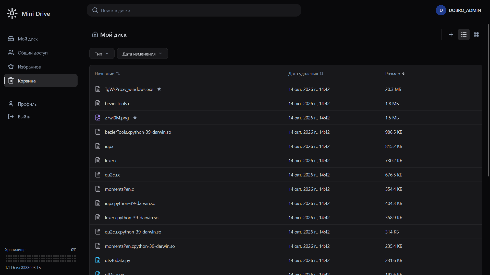
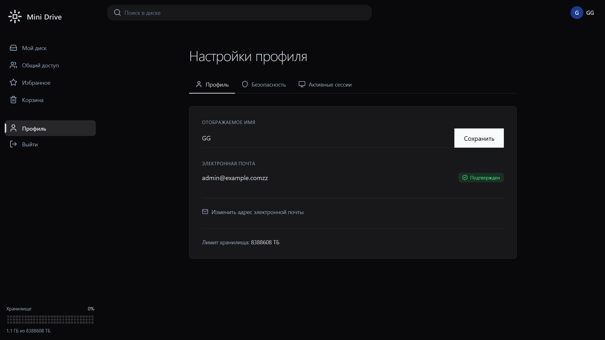

# Mini Drive

Учебный full-stack проект облачного файлового хранилища. В нём можно управлять файлами и папками, загружать файлы частями и работать с учётными записями пользователей.

Проект создан для практики разработки приложения на React и Spring Boot. Это не production-сервис: перед реальным развёртыванием потребуются дополнительный аудит, настройка инфраструктуры и усиление эксплуатационной безопасности.

## Возможности

- Регистрация, вход и обновление токенов доступа.
- Управление профилем, паролем, email и пользовательскими сессиями.
- Просмотр файлов и папок, создание папок и загрузка вложенных папок.
- Многочастная загрузка с контролем размера частей и квоты пользователя.
- Скачивание отдельных файлов и архива ZIP.
- Поиск по разделам «Мой диск», «Избранное», «Общие» и «Корзина», фильтры и курсорная загрузка.
- Перемещение элементов в корзину и в избранное.
- Очистка просроченных upload-сессий и старых файлов из корзины.

## Скриншоты

<!--  -->

<!--  -->

<!--  -->

<!--  -->

## Технологии

| Область | Технологии |
| --- | --- |
| Frontend | React 19, TypeScript, Vite, React Router, TanStack Query, Zustand, Tailwind CSS |
| Backend | Java 21, Spring Boot, Spring Security, Spring Data JPA, Spring Data Redis |
| Данные | PostgreSQL 16, Redis 7, Flyway |
| API и документация | REST, JWT, Springdoc OpenAPI |
| Запуск | Docker Compose |

## Архитектура

Frontend и backend разделены на самостоятельные приложения. Backend хранит метаданные файлов в PostgreSQL, временное состояние загрузок — в Redis, а содержимое файлов — в локальном хранилище. Docker Compose поднимает backend и необходимые ему сервисы; frontend запускается отдельно в режиме разработки.

## Требования

- Docker Desktop с Docker Compose.
- Node.js 20 или новее и npm.

Для запуска backend вне Docker также понадобятся JDK 21 и PostgreSQL/Redis; основной сценарий ниже запускает backend и его зависимости в контейнерах.

## Запуск локально

### 1. Настройте переменные окружения

Из корня репозитория скопируйте шаблон и откройте `.env`:

```powershell
Copy-Item .env.example .env
```

Заполните реальные параметры почтового сервера (`MAIL_HOST`, `MAIL_PORT`, `MAIL_USERNAME`, `MAIL_PASSWORD`) и задайте собственный длинный случайный `JWT_ACCESS_SECRET`. При необходимости измените параметры bootstrap-администратора.

### 2. Запустите приложение

Из корня репозитория запустите все сервисы — PostgreSQL, Redis, backend и frontend:

```powershell
docker compose up --build -d
```

Откройте frontend по адресу [http://localhost:5173](http://localhost:5173). API доступно по адресу [http://localhost:8080/api/v1](http://localhost:8080/api/v1).

Проверьте состояние контейнеров и при необходимости посмотрите логи:

```powershell
docker compose ps
docker compose logs -f backend
```

Первый запуск может занять несколько минут на сборку образов и применение миграций базы данных. Для изменения порта frontend задайте `FRONTEND_PORT` в `.env`. Если API доступно не по адресу `http://localhost:8080/api/v1`, укажите публичный адрес backend через `VITE_API_URL` в `.env` и пересоберите frontend:

```dotenv
VITE_API_URL=http://localhost:8080/api/v1
```

Остановка сервисов без удаления данных:

```powershell
docker compose down
```

Для удаления локальных данных базы и файлов используйте `docker compose down -v`. Эта команда безвозвратно удалит Docker volumes проекта.

## API-документация

После запуска backend:

- Swagger UI: [http://localhost:8080/swagger-ui.html](http://localhost:8080/swagger-ui.html)
- OpenAPI JSON: [http://localhost:8080/v1/api-docs](http://localhost:8080/v1/api-docs)
- Health endpoint: [http://localhost:8080/actuator/health](http://localhost:8080/actuator/health)

## API шаринга

- `GET /api/v1/share-targets/search?query=...` — поиск пользователей и групп. Минимум 3 символа, максимум 10 результатов каждого типа; текущий и удалённые пользователи не возвращаются.
- `GET /api/v1/shares/{nodeUuid}` — список прямых разрешений и состояние публичной ссылки. Только владелец узла.
- `POST /api/v1/shares` — добавить или обновить доступ на один файл или папку. Прямой доступ наследуется содержимым папки.
- `DELETE /api/v1/shares/{shareUuid}` — отозвать одну выдачу доступа или ссылку. Только владелец узла.
- `GET /api/v1/public/shares/{token}` — получить узел, доступный по публичной ссылке; для папки возвращает непосредственных потомков.
- `GET /api/v1/public/shares/{token}/nodes/{nodeUuid}` — перейти к узлу внутри расшаренной папки.
- `GET /api/v1/public/shares/{token}/nodes/{nodeUuid}/download` — скачать доступный по ссылке файл.

Пример тела `POST /api/v1/shares`:

```json
{
  "nodeUuid": "uuid-файла-или-папки",
  "userUuids": ["uuid-пользователя"],
  "groupUuids": ["uuid-группы"],
  "permission": "READ",
  "linkEnabled": false
}
```

Для прямой выдачи укажите непустой `userUuids` и/или `groupUuids`, а также `permission`; `linkEnabled` в этом запросе не передавайте или задайте `null`. Для управления публичной ссылкой отправьте отдельный запрос с `linkEnabled: true` (создать ссылку) или `linkEnabled: false` (отозвать её), не передавая списки получателей. Ссылка имеет право чтения. Пустые списки не удаляют существующие прямые выдачи; их можно отозвать по `shareUuid` из ответа `GET`.

## Структура репозитория

```text
.
├── backend/                 # Spring Boot REST API
│   ├── src/main/java/       # Приложение, API, бизнес-логика и доступ к данным
│   └── src/main/resources/  # Конфигурация и миграции Flyway
├── frontend/                # React-приложение
│   └── src/                 # Страницы, компоненты, API-клиент и состояние
├── docker-compose.yml       # Frontend, backend, PostgreSQL и Redis
└── README.md
```
