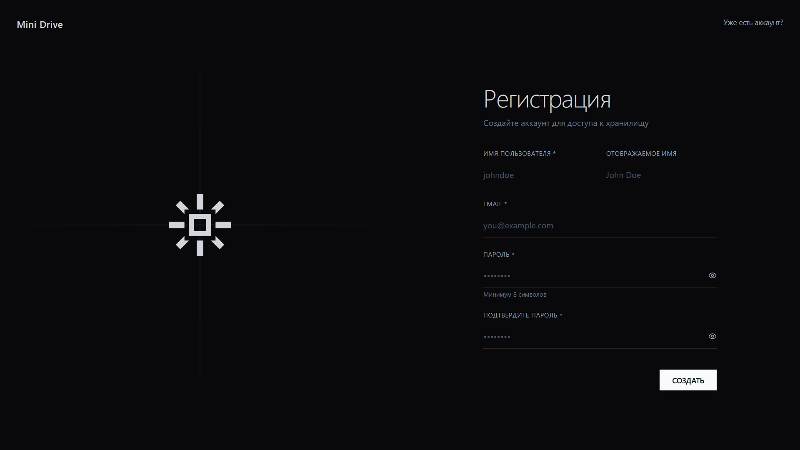
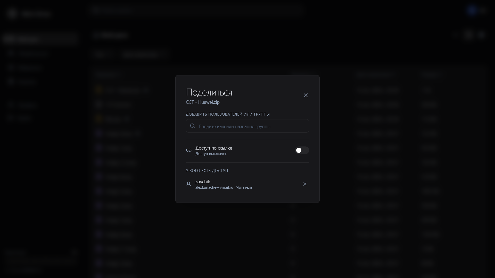

# Mini Drive

Учебный full-stack проект облачного файлового хранилища. 
P.S Для реализации фронтенд части активно применял нейронки.

## В чём суть

- Токенизированная аунтефикация.
- Чанковая загрузка файла с контролем размера чанка и квоты пользователя.
- Просмотр файлов и папок, создание папок и загрузка вложенных папок.
- Скачивание отдельных файлов и формирование временного ZIP архива для скачивания папки или группы файлов.
- Поиск по разделам «Мой диск», «Избранное», «Общие» и «Корзина», фильтры и курсорная загрузка.
- Перемещение элементов в корзину и в избранное.
- Очистка просроченных upload-сессий и старых файлов из корзины.
- Управление правами доступа к файлам на основании принадлежности к группе или на основании персонального разрешения.
- 4 уровня прав владения файлом
- Динамическая квота по следующему приоритету (персональная/max(групповых)/стандартная)

## Скриншоты






## Стек

| Область | Технологии |
| --- | --- |
| Frontend | React 19, TypeScript, Vite, React Router, TanStack Query, Zustand, Tailwind CSS |
| Backend | Java 21, Spring Boot, Spring Security, Spring Data JPA, Spring Data Redis |
| Данные | PostgreSQL 16, Redis 7, Flyway |
| API и документация | REST, JWT, Springdoc OpenAPI |
| Запуск | Docker Compose |

## Архитектура

Frontend и backend разделены на самостоятельные приложения. Backend хранит метаданные файлов в PostgreSQL, временное состояние загрузок — в Redis, а содержимое файлов — в локальном хранилище (пока только оно). Docker Compose поднимает backend и необходимые ему сервисы, а так же frontend

## Требования

- Docker Desktop с Docker Compose.
- Node.js 20 или новее и npm.

Для запуска backend вне Docker также понадобятся JDK 21 и PostgreSQL/Redis; основной сценарий ниже запускает backend и его зависимости в контейнерах.

## Запуск локально

### 1. Настройте переменные окружения

Из корня репозитория скопируйте шаблон и откройте `.env`:

```powershell
Copy-Item .env.example .env
```

Заполните реальные параметры почтового сервера (`MAIL_HOST`, `MAIL_PORT`, `MAIL_USERNAME`, `MAIL_PASSWORD`) и задайте собственный длинный случайный `JWT_ACCESS_SECRET`. При необходимости измените параметры bootstrap-администратора.

### 2. Запустите приложение

Из корня репозитория запустите все сервисы — PostgreSQL, Redis, backend и frontend:

```powershell
docker compose up --build -d
```

Откройте frontend по адресу [http://localhost:5173](http://localhost:5173). API доступно по адресу [http://localhost:8080/api/v1](http://localhost:8080/api/v1).

```dotenv
VITE_API_URL=http://localhost:8080/api/v1
```

Остановка сервисов без удаления данных:

```powershell
docker compose down
```

с удалением данных

```powershell
docker compose down -v
```

## API-документация

После запуска backend:

- Swagger UI: [http://localhost:8080/swagger-ui.html](http://localhost:8080/swagger-ui.html)
- OpenAPI JSON: [http://localhost:8080/v1/api-docs](http://localhost:8080/v1/api-docs)
- Health endpoint: [http://localhost:8080/actuator/health](http://localhost:8080/actuator/health)

